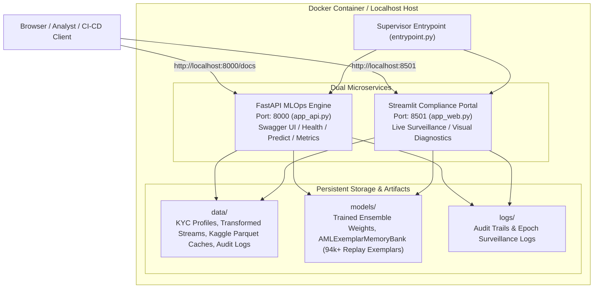

# 🐳 Enterprise AML MLOps & Docker Hosting Guide
**Production Deployment Manual: Multi-Service Architecture for Localhost & Containerized Cloud**

---

## 🏗️ 1. Architecture Overview

This project is packaged as a **production-grade MLOps system** with dual endpoints hosted on **localhost**:



### Key Ports on `localhost`:
* **Port `8501` (`http://localhost:8501`)**: **Streamlit Interactive Compliance Dashboard** (Live transaction surveillance feed, customer CDD profile cards, live risk meter, interactive 5-part FinCEN SAR generator, and overfitting/underfitting diagnostic graphs).
* **Port `8000` (`http://localhost:8000`)**: **FastAPI MLOps Service** (`/health`, `/models/info`, `/predict`, `/generate-sar`, `/metrics` with interactive OpenAPI Swagger UI at `http://localhost:8000/docs`).

---

## 🚀 2. Option A: Run via Docker (Recommended for MLOps)

### Prerequisites:
* [Docker Desktop](https://www.docker.com/products/docker-desktop/) installed and running.

### One-Click Launch (Windows):
Double-click [`run_docker.bat`](file:///c:/Users/DELL/Downloads/sar_narrative_generator/run_docker.bat).

### Terminal / Command Prompt:
```bash
# 1. Build and launch the container in the background
docker compose up -d --build

# 2. View real-time container startup and microservice logs
docker logs -f aml_sar_mlops_container

# 3. Check health status
docker ps
```

### Stopping the Container:
```bash
docker compose down
```

---

## 💻 3. Option B: Run Directly on Localhost (Without Docker)

If Docker is not running or you want instant native execution:

### One-Click Launch (Windows):
Double-click [`run_localhost.bat`](file:///c:/Users/DELL/Downloads/sar_narrative_generator/run_localhost.bat).

### Terminal / Command Prompt:
```bash
# 1. Start the FastAPI MLOps REST API (Port 8000)
python app_api.py

# 2. In a second terminal, start the Streamlit Dashboard (Port 8501)
streamlit run app_web.py --server.port 8501
```

Both services will be live at:
* Streamlit UI: **`http://localhost:8501`**
* FastAPI Swagger UI: **`http://localhost:8000/docs`**

---

## 📡 4. MLOps REST API Reference & Examples

### 1. Healthcheck & Readiness Probe (`GET /health`)
Used by Docker healthchecks and Kubernetes liveness probes:
```bash
curl -X GET "http://localhost:8000/health"
```
**Response (200 OK):**
```json
{
  "status": "healthy",
  "uptime_seconds": 128.45,
  "models_loaded": true,
  "total_customers_in_cdd": 300,
  "memory_bank_exemplars": 94560,
  "timestamp": "2026-11-16T10:30:00"
}
```

---

### 2. Model Metadata & Architecture (`GET /models/info`)
Inspects model version, training metrics, and feature schemas:
```bash
curl -X GET "http://localhost:8000/models/info"
```

---

### 3. Real-Time Transaction Screening (`POST /predict`)
Screen a single or batch of transactions for SAR violations:
```bash
curl -X POST "http://localhost:8000/predict" \
     -H "Content-Type: application/json" \
     -d '{
       "transactions": [
         {
           "transaction_id": "TXN-API-001",
           "customer_id": "CUST-0001",
           "amount": 9850.00,
           "transaction_type": "CASH_DEPOSIT",
           "channel": "BRANCH_COUNTER",
           "originator_country": "US",
           "beneficiary_country": "US"
         }
       ],
       "decision_threshold": 0.35
     }'
```
**Response (200 OK):**
```json
[
  {
    "transaction_id": "TXN-API-001",
    "customer_id": "CUST-0001",
    "amount": 9850.0,
    "is_sar_flagged": true,
    "sar_decision": "FLAGGED_SAR",
    "sar_risk_score": 44.32,
    "ensemble_probability": 0.4432,
    "aml_typology": "STRUCTURING",
    "rule_flags_triggered": [
      "CTR Structuring Avoidance ($9,000-$9,999)"
    ],
    "model_version": "Enterprise-AML-Ensemble-v2.0"
  }
]
```

---

### 4. Automated 5-Part FinCEN SAR Generation (`POST /generate-sar`)
Generates statutory SAR narrative with reversible PII masking and SHA-256 cryptographic seal:
```bash
curl -X POST "http://localhost:8000/generate-sar" \
     -H "Content-Type: application/json" \
     -d '{
       "customer_id": "CUST-0001",
       "investigator_name": "Compliance_Officer_Jane",
       "investigator_notes": "Repetitive sub-threshold cash structuring observed.",
       "mask_pii": true
     }'
```
**Response (200 OK):**
```json
{
  "case_id": "CASE-CUST-0001",
  "customer_id": "CUST-0001",
  "sar_risk_score": 73.43,
  "typologies_detected": ["STRUCTURING"],
  "pii_masking_applied": true,
  "statutory_sar_narrative": "PART I: EXECUTIVE SUMMARY\n--------------------------------------------------------------------------------\nThis Suspicious Activity Report (SAR) is submitted regarding suspicious financial conduct...",
  "cryptographic_seal_sha256": "c4e6636981e6528059382918614cf21270a980141abcde1b187a1edc07f693ab",
  "timestamp": "2026-11-16 10:35:00"
}
```

---

### 5. Prometheus / MLOps Metrics (`GET /metrics`)
Exposes live model accuracy, ROC-AUC, FPR, and exemplar memory stats for drift monitoring:
```bash
curl -X GET "http://localhost:8000/metrics"
```

---

## 💾 5. Datasets & Model Artifact Persistence

All trained model weights and datasets persist across container stops via **Docker host volumes**:

| Directory | Inside Container | Host Machine | Description |
| :--- | :--- | :--- | :--- |
| **`./data`** | `/app/data` | [`data/`](file:///c:/Users/DELL/Downloads/sar_narrative_generator/data) | Customer profiles, test transactions, Kaggle cached parquets (`data/cache/`), and immutable SHA-256 audit logs |
| **`./models`** | `/app/models` | [`models/`](file:///c:/Users/DELL/Downloads/sar_narrative_generator/models) | Trained ensemble weights (`trained_aml_models.pkl`) with 94k+ exemplar replay memory reservoir |
| **`./logs`** | `/app/logs` | [`logs/`](file:///c:/Users/DELL/Downloads/sar_narrative_generator/logs) | Epoch-by-epoch training logs and container runtime outputs |
